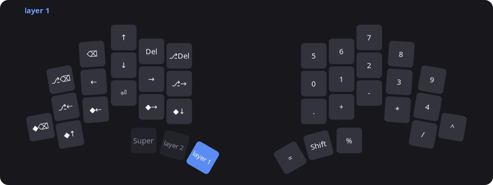

# totem-overlay

Shows the active layer of a ZMK keyboard on screen, and highlights keys as you press them.
Made for the GEIST TOTEM on Linux/Wayland. It runs as a normal window or as a click-through
overlay on top of everything, games included.



- The keyboard reports its active layer and pressed keys over Raw HID (USB or Bluetooth), using
  the ZMK module in this repo.
- The keymap and physical layout are read from the keyboard itself over USB (ZMK Studio), and
  cached so they also work over Bluetooth. A `.keymap` file can be used instead.

This repo holds both parts:

- `firmware/` + `zephyr/module.yml`: the ZMK module that sends layer and key reports
- the app (Rust, GTK 4): everything else

## 1. Firmware

In your zmk-config, add this module and [zzeneg/zmk-raw-hid](https://github.com/zzeneg/zmk-raw-hid)
to `config/west.yml`:

```yaml
manifest:
  remotes:
    - name: zmkfirmware
      url-base: https://github.com/zmkfirmware
    - name: zzeneg
      url-base: https://github.com/zzeneg
    - name: amunds1-dev
      url-base: https://github.com/amunds1-dev
  projects:
    - name: zmk
      remote: zmkfirmware
      revision: main
      import: app/west.yml
    - name: zmk-raw-hid
      remote: zzeneg
      revision: main
    - name: zmk-layer-overlay
      remote: amunds1-dev
      revision: main
  self:
    path: config
```

In `build.yaml`, add the `raw_hid_adapter` shield to the half that connects to the computer (the
central, usually the left half). Add the `studio-rpc-usb-uart` snippet so the app can read the
keymap:

```yaml
  - board: xiao_ble//zmk
    shield: totem_left raw_hid_adapter
    snippet: studio-rpc-usb-uart
```

and in your `.conf`:

```ini
CONFIG_ZMK_STUDIO=y
# Optional: without this, press your &studio_unlock key before the app can read the keymap.
CONFIG_ZMK_STUDIO_LOCKING=n
```

Build (GitHub Actions), then flash only that half: double-tap reset, copy the `.uf2`.

The module sends layer reports whenever Raw HID is enabled (`CONFIG_LAYER_OVERLAY_REPORT`). It also
reports pressed keys from both halves so the overlay can highlight them. To turn that off (saves a
little battery over Bluetooth), set `CONFIG_LAYER_OVERLAY_KEY_REPORT=n`.

Over Bluetooth, remove and re-pair the keyboard once after flashing, so the computer sees the new
Raw HID interface.

## 2. Install (Arch / CachyOS)

```sh
git clone https://github.com/amunds1-dev/zmk-layer-overlay.git
cd zmk-layer-overlay/packaging/arch
makepkg -si
```

This installs `totem-overlay`, a launcher entry ("TOTEM Overlay") and a udev rule that gives you
access to the keyboard's Raw HID and ZMK Studio ports. Unplug and replug the keyboard once
afterwards.

The package builds the latest commit of your checkout. To update: `git pull`, then run `makepkg -si` again.

### Other distributions

You need Rust, GTK 4, gtk4-layer-shell and hidapi (development packages). Then:

```sh
cargo build --release
sudo install -Dm755 target/release/totem-overlay /usr/local/bin/totem-overlay
sudo cp udev/70-totem-overlay.rules /etc/udev/rules.d/
sudo udevadm control --reload && sudo udevadm trigger
```

## 3. Use

Start **TOTEM Overlay** from your launcher, or run `totem-overlay`. Plug the keyboard in over USB
once, so the app can read the keymap. After that it also works over Bluetooth. The keymap is read
again every time the keyboard connects over USB, so changes made in ZMK Studio show up.

**Settings:**

- In window mode, right-click the window.
- In overlay mode, which can't be clicked, run `totem-overlay --settings`. Starting the app again
  from the launcher also opens the settings.

Settings are saved to `~/.config/totem-overlay/config.toml`:

| Setting | Default | |
|---|---|---|
| `mode` | `window` | `window`: a normal window you can move and resize. `overlay`: always on top, click-through. |
| `show` | `always` | `layers`: only show while a layer other than the base layer is active |
| `background_opacity`, `key_opacity` | `0.88`, `1.0` | |
| `position` | `bottom` | Overlay anchor: `top`, `bottom`, `left`, `right`, `top-left`, `top-right`, `bottom-left`, `bottom-right`, `center` |
| `margin`, `scale` | `40`, `1.0` | Overlay distance from the screen edges (px) and size |
| `product` | `TOTEM` | Only use Raw HID keyboards whose name contains this (`""` for any) |
| `keymap_file` | | A `.keymap` file to use when the keymap can't be read from the keyboard (see below) |

Most settings also have a command-line flag that applies to one run only, e.g.
`totem-overlay --mode overlay --position top-right`. See `totem-overlay --help`.

**Layer names:** ZMK only knows layer names you have set. Either rename the layers in ZMK
Studio, or add `display-name = "Nav";` to each layer in your keymap. Without names, the layers show
as "layer 1", "layer 2" and so on.

**Key labels** use US key names, since that is what ZMK's keycodes mean.

### MangoWM

In `~/.config/mango/config.conf`:

```
# Window mode: floating, on top, on every tag, not blurred or dimmed, doesn't steal focus
window_rule=is_floating:1,is_overlay:1,is_global:1,no_border:1,no_blur:1,no_shadow:1,unfocused_opacity:1.0,is_open_silent:1,app_id:^totem-overlay$

# Start with the session, and open the settings with a key
exec_once=totem-overlay
bind=SUPER+SHIFT,k,spawn,totem-overlay --settings
```

`no_blur:1` matters if you use `blur=1`: without it, the see-through background shows a blurred
wallpaper instead of the windows behind it. You can add `width`, `height`, `offset_x` and `offset_y`
to the rule to place the window.

Overlay mode works on any compositor with wlr-layer-shell, e.g. MangoWM, Hyprland, Sway, niri
or KDE. GNOME doesn't support layer-shell, so use window mode there.

### Using a keymap file instead

If your firmware doesn't have ZMK Studio, or the keyboard has never been connected over USB, the
app can read your `.keymap` file. Set it in the settings ("Keymap file"), or as
`keymap_file = "~/zmk-config/config/totem.keymap"` in `config.toml`. The file is reloaded when you
save it.

A keymap read from the keyboard always takes priority over the file. The file doesn't describe the
physical layout, so the TOTEM layout is used. Common behaviors and the hold-taps, mod-morphs and
tap-dances defined in the keymap get proper labels. Others show their name.

## Troubleshooting

- **See what the keyboard sends:** `totem-overlay --monitor` prints layer changes and pressed keys
  without opening a window. If nothing connects, check that the new firmware is on the central half,
  and that the udev rule is installed (`ls -l /dev/hidraw*`).
- **Check the keymap:** `totem-overlay --fetch-keymap` reads it over USB and prints it.
  - *No permission for /dev/ttyACM…*: install the udev rule, or add yourself to the `uucp` group.
  - *Doesn't answer ZMK Studio requests*: the firmware is missing `CONFIG_ZMK_STUDIO=y` or the
    `studio-rpc-usb-uart` snippet.
- **Keys show numbers instead of labels:** the keymap hasn't been read yet. Connect the keyboard
  over USB once, or set a keymap file.
- **A window instead of an overlay:** the compositor doesn't support wlr-layer-shell.

## Development

```sh
cargo run -- --demo        # fake layer changes and key presses, no keyboard needed
cargo test
cargo clippy --all-targets
```

`--render out.png 960 360 --layer 1` draws one frame to a PNG. `--parse-keymap FILE` prints how a
`.keymap` file is read. ZMK key names come from `src/keymap_file/zmk-defines.h`, which is generated
by `tools/gen-zmk-defines.py` from ZMK's headers (see the script for how to regenerate it).

The Raw HID protocol is documented in `firmware/src/layer_report.c`. Design notes are in
`docs/rust-rewrite-plan.md`.

## License

MIT, see [LICENSE](LICENSE).
